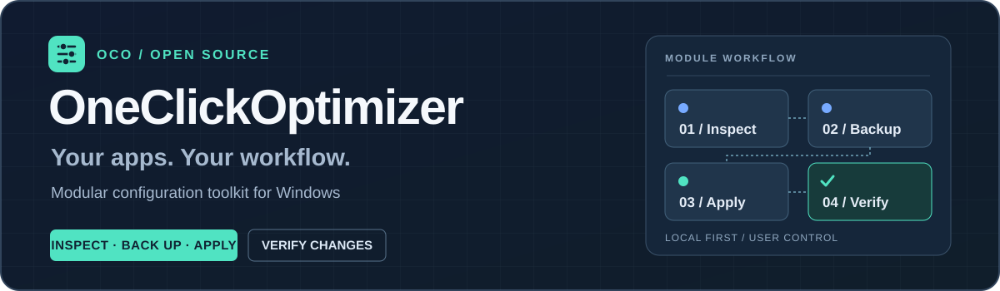

# OneClickOptimizer

**Software optimization, one click away.** Open-source modular Windows application presets: detect, back up, apply and verify. No universal speedup promised.

[简体中文](README.zh-CN.md) · [All releases](https://github.com/Kitty-Carter/OneClickOptimizer/releases) · [Windows CI](https://github.com/Kitty-Carter/OneClickOptimizer/actions/workflows/windows-test.yml) · [MIT](LICENSE)

## Choose your application

| Positron | Clash Verge Rev |
| :---: | :---: |
| **Research workflow & configuration** | **Network configuration & PC monitoring** |
| v0.1.0-alpha.1 · Windows preview | v0.3.0-alpha.1 · Windows preview |
|  |  |
| [Release notes](https://github.com/Kitty-Carter/OneClickOptimizer/releases/tag/v0.1.0-alpha.1) · [Module guide](modules/positron) | [Release notes](https://github.com/Kitty-Carter/OneClickOptimizer/releases/tag/clash-v0.3.0-alpha.1) · [Module guide](modules/clash-verge-rev) |
| Seven workflow settings, checks and backups | DNS, rules, AI routing preset; separate read-only NIC and hardware monitor |

## Get started

Download the standalone ZIP for your application, extract all files and read START-HERE.txt. Check before applying and preserve custom settings. For Clash, Native-Monitor.bat opens the Rust basic monitor, Monitor.bat the richer hardware window, and Restore.bat restores a verified OCO backup. The historical Positron toolkit release contains Positron only.

## Safety and compatibility

Development previews, not stable releases. Positron preferences may hide useful diagnostics. Clash's China-oriented DNS preset stages default extensions only on the validated app version; reactivate the subscription and check actual routing. Monitoring is a separate Windows window, not a modified official client. GPU is a busiest-engine estimate, not overall utilization; temperatures are not implemented. Local-only; no forced shutdown or credential collection. Cross-machine and full recovery acceptance remain pending.

[Source ZIP](https://github.com/Kitty-Carter/OneClickOptimizer/archive/refs/heads/main.zip) · [Module contract](docs/MODULE-CONTRACT.md) · [Roadmap](docs/ROADMAP.md) · [Validation](docs/VALIDATION.md) · [Changelog](CHANGELOG.md)

MIT · Independent community project, not affiliated with Positron or Clash Verge Rev.
