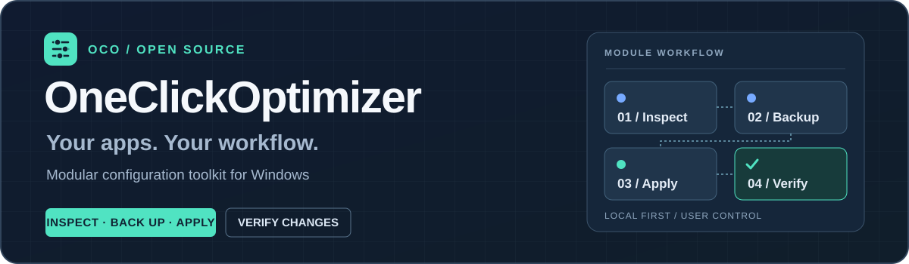

# OneClickOptimizer · 一键优化全家桶

**让软件优化，只需一键。** 面向 Windows 的开源模块化优化工具。检测、备份、应用、验证；不承诺普遍提速。

[English](README.md) · [全部发布](https://github.com/Kitty-Carter/OneClickOptimizer/releases) · [Windows CI](https://github.com/Kitty-Carter/OneClickOptimizer/actions/workflows/windows-test.yml) · [MIT](LICENSE)

## 选择要优化的软件

| Positron | Clash Verge Rev |
| :---: | :---: |
| **配置与科研工作流优化** | **网络配置与电脑监视** |
| v0.1.0-alpha.1 · Windows 预览 | v0.3.0-alpha.3 · Windows 预览 |
|  |  |
| [发布说明](https://github.com/Kitty-Carter/OneClickOptimizer/releases/tag/v0.1.0-alpha.1) · [模块指南](modules/positron) | [发布说明](https://github.com/Kitty-Carter/OneClickOptimizer/releases/tag/clash-v0.3.0-alpha.3) · [模块指南](modules/clash-verge-rev) |
| 七项工作流配置、检查及备份 | DNS、规则、AI 固定出口预设；独立只读网速与硬件监视 |

## 快速开始

下载所需模块的独立 ZIP，完整解压，阅读 START-HERE.txt。先检查，再确认优化；不要覆盖自定义配置。Clash 的 Native-Monitor.bat 打开 Rust 基础监视，Monitor.bat 打开硬件监视，Restore.bat 恢复经校验的 OCO 备份。现有 Positron 旧全家桶附件仅含 Positron，不含 Clash。

## 安全与兼容性

预览版，并非稳定版。Positron 的部分工作流偏好可能隐藏有用诊断。Clash 的 DNS 预设面向中国大陆网络，自动写入仅允许默认扩展和验证过的应用版本，需要用户重新激活订阅并检查网络。监视器是独立窗口，不是已修改的官方客户端；GPU 显示最繁忙引擎估计，温度等未实现。仅本地采集，不上传私人配置，不自动安装软件、不强制关闭应用。多机及完整恢复验收尚未完成。

[源码 ZIP](https://github.com/Kitty-Carter/OneClickOptimizer/archive/refs/heads/main.zip) · [模块契约](docs/MODULE-CONTRACT.md) · [路线图](docs/ROADMAP.md) · [验证记录](docs/VALIDATION.md) · [更新记录](CHANGELOG.md)

MIT · 独立社区项目，与 Positron 或 Clash Verge Rev 官方无隶属关系。
