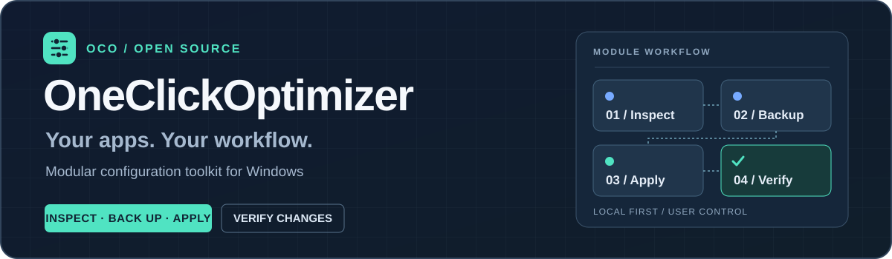

## Positron 一键优化工具 | Featured module

**Windows 开发预览版 · OneClickOptimizer 首发模块**

### 下载 / Download

| 下载选项 | 适用对象 |
| :--- | :--- |
| **[⬇ 下载 Positron 独立版](https://github.com/Kitty-Carter/OneClickOptimizer/releases/download/v0.1.0-alpha.1/Positron-%E4%B8%80%E9%94%AE%E4%BC%98%E5%8C%96%E5%B7%A5%E5%85%B7-Windows.zip)** | **推荐** · 只想优化 Positron 的用户 |
| [⬇ 下载 OneClickOptimizer 全家桶预览版](https://github.com/Kitty-Carter/OneClickOptimizer/releases/download/v0.1.0-alpha.1/OneClickOptimizer-%E5%85%A8%E5%AE%B6%E6%A1%B6%E9%A2%84%E8%A7%88%E7%89%88-Windows.zip) | 想体验统一入口及模块扩展的用户 |
| [SHA256SUMS.txt](https://github.com/Kitty-Carter/OneClickOptimizer/releases/download/v0.1.0-alpha.1/SHA256SUMS.txt) | 下载完整性校验 |

两种 ZIP 当前都包含相同的 Positron 优化功能，不必两个都下载。普通用户无需下载 Source code。

### 三步开始 / Quick start

1. 下载 **Positron 独立版**，将所有文件解压到普通文件夹。
2. 双击 `仅检查不修改.bat`，核对路径和待修改配置。
3. 保存工作，双击 `一键优化.bat`，输入 Y 确认，完成后自行重启 Positron。

Windows 10/11 · Windows PowerShell 5.1 · 已安装 Positron · 无需管理员权限。

### 七项工作流配置

Quarto 大纲、编辑器标尺、滚轮缩放、R 包安装器、Quarto 内联输出、Notebook Console 和 R 诊断设置。提供自动安装定位、只读检查、修改前备份、自检及回读验证。

> [!IMPORTANT]
> 开发预览版，不保证提速。关闭 R 诊断可能隐藏警告；特殊路径可能需手动指定，工作区及 Profile 可能覆盖用户设置。自动恢复、多机和完整 GUI 验收尚未完成，手动恢复见包内使用说明。

**English:** Download the standalone Positron ZIP (recommended), extract everything, run the check-only BAT first, then optimize with confirmation and restart Positron manually. Both packages contain the same Positron preset. Preview only; no universal speed claim or automated rollback.

[使用指南 / Guide](https://github.com/Kitty-Carter/OneClickOptimizer/tree/main/modules/positron) · [问题反馈 / Issues](https://github.com/Kitty-Carter/OneClickOptimizer/issues) · [自动测试 / Actions](https://github.com/Kitty-Carter/OneClickOptimizer/actions)

*OneClickOptimizer · Independent open-source toolkit, not affiliated with Posit. MIT License.*
